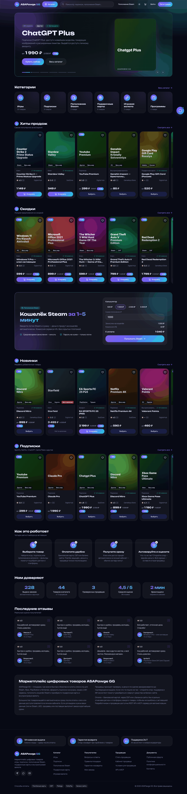
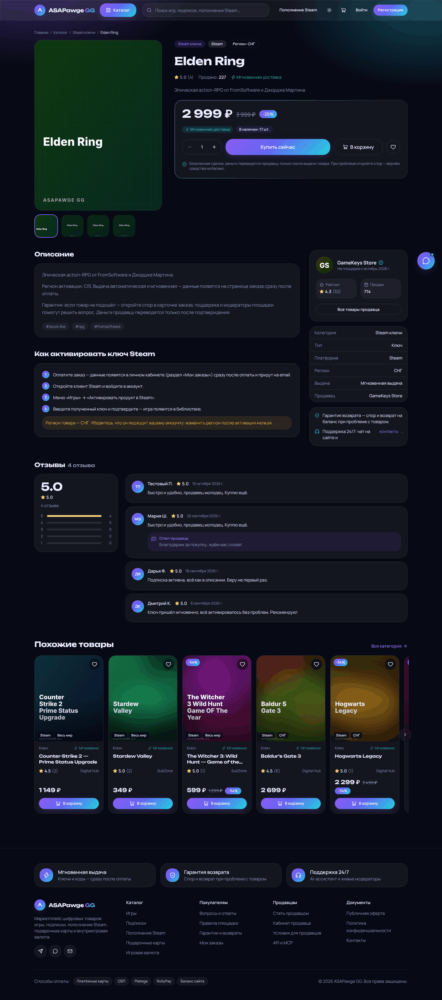

# ASAPawge GG

Маркетплейс цифровых товаров (по мотивам ggsel.net и igm.gg): ключи игр, подписки (Spotify, Netflix, ChatGPT Plus, Game Pass, PS Plus, Discord Nitro…), пополнение Steam, подарочные карты и внутриигровая валюта.
Три роли — покупатель, продавец, администратор; автовыдача товара, AI-модерация и AI-чат поддержки, REST API и MCP-сервер для подключения любых агентов, админ-аналитика и Яндекс Метрика.

Интерфейс — на русском, цены в рублях (в БД хранятся целыми копейками), код и комментарии — на английском.

| Главная | Товар |
|---|---|
|  |  |

Скриншоты (desktop 1440 и mobile 390) всех ключевых страниц лежат в [`docs/screenshots/`](docs/screenshots): главная, каталог, товар, пополнение Steam, корзина, заказ в кабинете, дашборды продавца и администратора.

---

## Возможности

**Витрина**
- Главная: GSAP-карусель, категории с реальными счётчиками, «Хиты», «Скидки», «Новинки», «Подписки», блок пополнения Steam с калькулятором, отзывы, статистика из БД.
- Каталог с серверными фильтрами (тип, платформа, регион, цена, наличие, скидка), 6 сортировок, пагинация, мобильные фильтры.
- Поиск: `pg_trgm` + теги + словарь алиасов («гта», «спотифай»…) + исправление неверной раскладки, подсказки на лету (Redis-кэш).
- Страница товара: галерея, варианты, количество, отзывы, похожие товары, JSON-LD (Product / AggregateRating / BreadcrumbList), `sitemap.xml`, `robots.txt`.
- Пополнение Steam по логину: проверка логина, комиссия из настроек, суммы в RUB и KZT.
- Корзина (гостевая сливается с аккаунтом при входе), промокоды, избранное.

**Оплата и заказы**
- Платёжные адаптеры Platega (СБП/карты) и RollyPay + баланс сайта + **тестовая оплата (sandbox)**, если ключей нет.
- Webhook: проверка подписи, идемпотентность (`WebhookEvent` + Redis-lock), сверка суммы; платёж, пришедший на отменённый заказ, не теряется — зачисляется на баланс.
- Двойная запись в леджере (`LedgerEntry`): баланс покупателя, холд и доступный баланс продавца, комиссия площадки; кэш балансов всегда равен леджеру (`bash scripts/check-ledger.sh`).
- Конечный автомат заказа (`PENDING → PAID → PROCESSING → DELIVERED → DISPUTED/REFUNDED`), резервирование ключей (`FOR UPDATE SKIP LOCKED`), автоотмена неоплаченных через 30 минут.

**Автовыдача (Python-воркер)**
- `AUTO_STOCK` — расшифровка зарезервированных ключей (AES-256-GCM), `AUTO_PROVIDER` — пополнение Steam через адаптер поставщика (mock или HTTP), `MANUAL` — продавец вручную.
- Если воркер недоступен, веб-приложение выдаёт заказ само (in-process fallback), а потом воркер ничего не дублирует.
- Cron: освобождение холдов продавцам, снятие просроченных резервов, агрегация дневных метрик, добивание «застрявших» оплаченных заказов, сверка статусов платежей.

**Кабинеты**
- Покупатель `/account`: заказы и ключи (показ только по кнопке, расшифровка на сервере), баланс и пополнение, избранное, отзывы, споры с чатом, API-ключи, настройки.
- Продавец `/seller`: дашборд (выручка, комиссия, конверсия, график), товары (CRUD, AI-описание, модерация), склад ключей (textarea/CSV, дедупликация, шифрование), заказы с ручной выдачей, отзывы, споры, выплаты (карта с проверкой Луна, СБП, USDT, ЮMoney).
- Администратор `/admin`: метрики (GMV, чистая выручка, конверсия, AOV, DAU/MAU, воронка, когорты — Recharts), пользователи/роли/бан, продавцы, модерация товаров, заказы/возвраты, споры, выплаты, категории, промокоды, настройки (комиссия, холд, AI, платёжки, Метрика), аудит-лог, AI-логи.

**AI, REST API, MCP**
- Единый адаптер LLM: OpenAI, Anthropic Claude, OpenRouter, цепочка фолбэка, лог каждого вызова в `AiLog`; без ключей — офлайн-эвристики и mock.
- AI-чат поддержки на сайте (SSE, tool-calling: статус заказа, поиск товаров, FAQ, вызов оператора), AI-описания для продавцов, AI-модерация товаров/отзывов/споров, фрод-скоринг заказов.
- REST API `/api/v1/*` с ключами и scope по роли + OpenAPI 3.1 (`/api/v1/openapi.json`), страница `/developers`.
- MCP-сервер (Streamable HTTP + stdio), инструменты зависят от роли ключа.

---

## Архитектура

```
              ┌────────────────────────── браузер / агенты ──────────────────────────┐
              │ сайт                         REST /api/v1                MCP-клиенты │
              └──────┬───────────────────────────┬──────────────────────────┬────────┘
                     ▼                           ▼                          ▼
              ┌──────────────────────────────────────────┐        ┌──────────────────┐
              │ apps/web — Next.js 16 (RSC, Server       │ ◄───── │ apps/mcp         │
              │ Actions, route handlers, Auth.js v5)     │ REST   │ MCP-сервер (TS)  │
              └───┬───────────────┬──────────────┬───────┘        └──────────────────┘
        Prisma    │               │ ioredis      │ HTTP /internal/jobs/*  (Bearer)
                  ▼               ▼              ▼
          ┌─────────────┐  ┌────────────┐  ┌───────────────────────────────────────┐
          │ PostgreSQL  │  │   Redis    │◄─┤ apps/worker — FastAPI + arq (Python)  │
          │ + pg_trgm   │  │ кэш, лимиты│  │ автовыдача, холды, AI-задачи, cron    │
          └─────────────┘  │ блокировки,│  └───────────────────────────────────────┘
                 ▲         │ очередь arq│                 │ SQLAlchemy / asyncpg
                 └─────────┴────────────┴─────────────────┘
```

| Путь | Что это |
|---|---|
| `apps/web` | Next.js 16 (App Router, RSC, Server Actions), React 19, TypeScript strict, Tailwind v4, GSAP, shadcn-стиль на Radix, Auth.js v5, Recharts |
| `apps/worker` | Python 3.13: FastAPI (внутренний API) + arq (очередь на Redis), SQLAlchemy 2 async, pytest |
| `apps/mcp` | MCP-сервер на TypeScript (`@modelcontextprotocol/sdk`): Streamable HTTP (stateless) + stdio |
| `packages/db` | Prisma 7: схема, миграции, seed, клиент |
| `packages/shared` | zod-схемы, константы, деньги (копейки), шифрование склада, расчёт Steam-пополнения |
| `docs/CONTRACTS.md` | Контракты между модулями: леджер, статусы заказов, формат шифрования, контракты воркера и API |

---

## Быстрый старт без Docker

Нужны: Node.js ≥ 22, pnpm ≥ 10, Python 3.13, PostgreSQL 16, Redis 7.

```bash
# 1. Сервисы и окружение
bash scripts/services.sh start      # поднимает PostgreSQL + Redis, создаёт роль и БД asap/asapawge
cp .env.example .env                # значения по умолчанию подходят для локальной разработки

# 2. Зависимости, миграции, демо-данные
pnpm install                        # postinstall генерирует Prisma-клиент
pnpm db:deploy                      # применяет миграции (создаёт расширение pg_trgm)
pnpm db:seed                        # ВНИМАНИЕ: очищает таблицы и заливает демо-данные

# 3. Python-воркер
python3.13 -m venv apps/worker/.venv
apps/worker/.venv/bin/pip install -r apps/worker/requirements.txt

# 4a. Режим разработки (каждый процесс в своём терминале)
pnpm dev                            # сайт        http://localhost:3000
pnpm dev:worker                     # воркер API  http://localhost:8000/docs  + очередь arq
pnpm --filter @asap/mcp dev         # MCP         http://localhost:3333/mcp

# 4b. Или production-сборка и весь стек одной командой (логи и pid в .run/)
pnpm build
pnpm stack:start                    # web :3000, worker :8000, arq, mcp :3333
pnpm stack:stop
```

Без воркера сайт тоже работает: заказы выдаются встроенным fallback-ом, но AI-задачи, cron холдов и агрегация метрик не выполняются.

### Демо-аккаунты (после `pnpm db:seed`)

| Роль | Email | Пароль |
|---|---|---|
| Администратор | `admin@asapawge.gg` | `Admin123!` |
| Продавец «Digital Hub» | `seller@asapawge.gg` | `Seller123!` |
| Продавцы «GameKeys Store», «SubZone» | `gamekeys@asapawge.gg`, `subzone@asapawge.gg` | `Seller123!` |
| Покупатель (баланс 5 000 ₽) | `user@asapawge.gg` | `User123!` |

В демо-данных: 49 товаров, ~1 200 ключей на складе, ~250 заказов за 60 дней, отзывы, события аналитики.

### Сценарий «купить товар» за минуту

1. Войдите как `user@asapawge.gg`, откройте любой товар с пометкой «Мгновенная доставка» → «Купить сейчас».
2. Способ оплаты «Баланс сайта» (или «Тестовая оплата» → «Оплатить») → страница успеха покажет «Заказ выдан!».
3. `/account/orders/<id>` → «Показать» — ключ расшифровывается на сервере только по вашему запросу.

---

## Запуск в Docker

```bash
cp .env.example .env     # ОБЯЗАТЕЛЬНО смените AUTH_SECRET, STOCK_ENCRYPTION_KEY, WORKER_INTERNAL_TOKEN, SANDBOX_WEBHOOK_SECRET
docker compose up -d --build postgres redis
docker compose --profile tools run --rm migrate                      # миграции
docker compose --profile tools run --rm migrate pnpm db:seed         # демо-данные (по желанию, очищает БД!)
docker compose up -d --build web worker worker-jobs mcp
```

Сервисы: `web` :3000, `worker` :8000 (внутренний API), `worker-jobs` (потребитель очереди arq), `mcp` :3333, `postgres` :5432, `redis` :6379. Все контейнеры читают одни и те же переменные из `.env`.

> `STOCK_ENCRYPTION_KEY` общий для web и воркера. Смена ключа делает уже загруженные ключи на складе нечитаемыми — сгенерируйте его один раз: `openssl rand -base64 32`.

---

## Деплой на Vercel + Supabase

Разворачивается только `apps/web` (Vercel Hobby, **Root Directory = `apps/web`**, включите «Include source files outside of the Root Directory»). БД — Supabase Postgres. Redis и Python-воркер **не нужны**. Сборка и установка описаны в [`apps/web/vercel.json`](apps/web/vercel.json) (установка всего workspace из корня, `prisma generate` перед `next build`).

**Переменные окружения (Vercel → Settings → Environment Variables):**

| Переменная | Значение |
|---|---|
| `DATABASE_URL` | строка Supabase **Transaction pooler** (порт `6543`, `postgres.<ref>@…pooler.supabase.com`) — для приложения |
| `DIRECT_URL` | прямое подключение (`db.<ref>.supabase.co:5432`) или Session pooler (`5432`) — только для миграций с вашей машины/CI |
| `AUTH_SECRET` | `openssl rand -base64 32` |
| `STOCK_ENCRYPTION_KEY` | `openssl rand -base64 32` (один раз; смена делает ключи на складе нечитаемыми) |
| `WORKER_INTERNAL_TOKEN` | любой секрет ≥ 16 символов (нужен стартовой проверке и защищает `/api/payments/maintenance`) |
| `CRON_SECRET` | то же значение, что `WORKER_INTERNAL_TOKEN` — Vercel Cron вызывает `/api/payments/maintenance` раз в сутки (лимит Hobby) |
| `SANDBOX_WEBHOOK_SECRET` | свой секрет (иначе тестовая оплата отключается); платёжные ключи Platega/Rollypay, AI-ключи — по желанию |
| `APP_URL`, `NEXT_PUBLIC_APP_URL` | необязательны: без них берётся `https://$VERCEL_PROJECT_PRODUCTION_URL` (превью — `$VERCEL_URL`). Для своего домена задайте явно |

Не задавайте `REDIS_URL` и `WORKER_URL` — без них Redis и воркер отключены (никаких попыток подключиться к localhost, запросы не ждут таймаутов).

**Пул подключений.** На Vercel каждый инстанс держит свой пул, поэтому по умолчанию `max=3` (`DATABASE_POOL_MAX` переопределяет). Для хостов `*.supabase.com/.co` соединение шифруется без проверки цепочки сертификатов (`DATABASE_SSL_STRICT=1` включает проверку). Prisma-адаптер `pg` использует только безымянные запросы, а блокировки (`SELECT … FOR UPDATE`) живут внутри интерактивных транзакций, поэтому transaction pooling совместим. Миграции через pooler на `6543` не запускайте — используйте `DIRECT_URL`:

```bash
DIRECT_URL='postgresql://postgres:…@db.<ref>.supabase.co:5432/postgres' pnpm db:deploy
# демо-данные (ОЧИЩАЕТ БД!) — по желанию: DIRECT_URL=… pnpm db:seed
```

**Без Redis:** кэш — сквозной (данные считаются на каждый запрос), rate limit — в памяти инстанса (лимиты действуют в пределах одного инстанса), блокировки — локальные на инстанс; корректность держится на `FOR UPDATE`/уникальных ограничениях БД (идемпотентность вебхуков, выдача заказа, резерв склада). `Idempotency-Key` REST API хранится в таблице `Setting`.

**Без воркера** (`enqueueJob` сразу возвращает `ok:false`) не работает:

- выдача заказов выполняется сразу в самом запросе (AUTO_STOCK и sandbox-пополнения — работают; реальный поставщик Steam и AUTO_PROVIDER, который ведёт воркер, остаются в `PROCESSING`);
- **освобождение холда** — продавцам не переводятся заработанные средства из холда в доступный баланс (job `release_holds`);
- **истечение резервов и неоплаченных заказов** — выполняется лениво при создании заказа и раз в сутки по Vercel Cron (`/api/payments/maintenance`), а не раз в минуту;
- **ежедневные снимки метрик** (`aggregate_daily_metrics`) — не создаются, дашборды считают данные на лету;
- **AI-модерация товаров/отзывов и антифрод-скоринг** — товар после отправки остаётся в `PENDING_REVIEW` до решения администратора; кнопка «Перепроверить AI» работает inline.

---

## Переменные окружения

Полный список с комментариями — в [`.env.example`](.env.example). Все ключи внешних сервисов необязательны: без них включаются явно помеченные sandbox/mock-режимы.

| Группа | Переменные | Назначение |
|---|---|---|
| Ядро | `DATABASE_URL`, `REDIS_URL`, `APP_URL`, `NEXT_PUBLIC_APP_URL` | БД, Redis, публичный URL (редиректы оплаты, sitemap) |
| Auth.js | `AUTH_SECRET`, `AUTH_URL`, `AUTH_TRUST_HOST` | подпись сессий (`openssl rand -base64 32`) |
| Склад | `STOCK_ENCRYPTION_KEY` | AES-256-GCM, 32 байта в base64 или 64 hex-символа |
| Платежи | `PLATEGA_MERCHANT_ID/SECRET/API_URL`, `ROLLYPAY_API_KEY/SECRET/API_URL`, `SANDBOX_WEBHOOK_SECRET`, `ALLOW_SANDBOX_PAYMENTS`, `PLATEGA_*_PATH/HEADER/METHOD_*`, `ROLLYPAY_*_PATH/HEADER` | реквизиты и переопределение путей/заголовков API |
| AI | `AI_PROVIDER` (`mock\|openai\|anthropic\|openrouter`), `AI_MODEL`, `OPENAI_API_KEY`, `ANTHROPIC_API_KEY`, `OPENROUTER_API_KEY` | провайдеры LLM |
| Метрика | `NEXT_PUBLIC_YM_ID` | счётчик Яндекс Метрики (или в админке) |
| Воркер | `WORKER_URL`, `WORKER_INTERNAL_TOKEN`, `WEB_INTERNAL_URL` | связь web ↔ worker (Bearer-токен) |
| Steam | `STEAM_TOPUP_PROVIDER` (`mock\|http`), `STEAM_TOPUP_API_URL`, `STEAM_TOPUP_API_KEY` | поставщик пополнений |
| MCP | `MCP_PORT`, `MCP_API_BASE_URL` | порт и адрес REST API |
| Бизнес | `COMMISSION_DEFAULT_BPS` (1000 = 10 %), `HOLD_DAYS` | значения по умолчанию, меняются в админке |

---

## Подключение платёжных провайдеров

Адаптеры написаны по публичной схеме API и **должны быть сверены с актуальной документацией провайдеров перед продакшеном** (пути, имена полей и ID методов оплаты вынесены в переменные окружения).

1. **Platega.** В личном кабинете получите Merchant ID и секрет → `PLATEGA_MERCHANT_ID`, `PLATEGA_SECRET`. Callback URL в настройках магазина: `https://<ваш-домен>/api/payments/webhook/platega` (подлинность проверяется по заголовкам `X-MerchantId` / `X-Secret`, имена — `PLATEGA_MERCHANT_HEADER`, `PLATEGA_SECRET_HEADER`). ID методов СБП и карт — `PLATEGA_METHOD_SBP`, `PLATEGA_METHOD_CARD`.
2. **RollyPay.** `ROLLYPAY_API_KEY`, `ROLLYPAY_SECRET`; webhook: `https://<ваш-домен>/api/payments/webhook/rollypay` (HMAC-SHA256 тела запроса в заголовке `ROLLYPAY_SIGNATURE_HEADER`).
3. Включите/отключите способы оплаты в `/admin/settings` → «Платежи».
4. **Sandbox** («Тестовая оплата») доступен в разработке всегда, а в продакшене — пока не настроен ни один реальный шлюз либо при `ALLOW_SANDBOX_PAYMENTS=1`. Смените `SANDBOX_WEBHOOK_SECRET`, если окружение доступно из интернета.
5. Страница успеха никогда не доверяет редиректу шлюза: она показывает реальное состояние платежа из БД и при необходимости сама опрашивает провайдера.

Проверка webhook руками (sandbox):

```bash
BODY='{"eventId":"t1","externalId":"sbx_<paymentId>","status":"PAID","amount":34900}'
SIG=$(printf '%s' "$BODY" | openssl dgst -sha256 -hmac "$SANDBOX_WEBHOOK_SECRET" -hex | sed 's/^.* //')
curl -X POST http://localhost:3000/api/payments/webhook/sandbox -H "content-type: application/json" -H "x-signature: $SIG" -d "$BODY"
```

## Подключение AI-провайдеров

1. Задайте один или несколько ключей: `OPENAI_API_KEY`, `ANTHROPIC_API_KEY`, `OPENROUTER_API_KEY`.
2. Основной провайдер и модель — `/admin/settings` → «AI» (или `AI_PROVIDER`/`AI_MODEL`). Если основной недоступен, вызов уходит по цепочке к остальным провайдерам с ключами, а затем — на офлайн-эвристики.
3. Порог автопубликации товаров (по умолчанию 80/100) тоже в настройках; всё, что ниже, попадает в очередь модерации `/admin/products`.
4. Журнал вызовов (токены, задержка, ошибки) — `/admin/ai-logs`.

Воркер читает те же ключи из окружения (модерация, фрод-скоринг, споры).

## Яндекс Метрика

1. Создайте счётчик, включите «Вебвизор» и «Электронную коммерцию» (контейнер `dataLayer`).
2. Укажите номер счётчика в `NEXT_PUBLIC_YM_ID` **или** в `/admin/settings` → «Аналитика» (значение из админки применяется без пересборки).
3. Цели создайте с теми же идентификаторами: `view_item`, `add_to_cart`, `begin_checkout`, `purchase`, `sign_up`, `login`, `topup_balance`, `steam_topup_start`, `search`, `favorite_add`, `review_submit`, `dispute_open`, `ai_chat_message`.
4. Параллельно все события пишутся в собственную таблицу `AnalyticsEvent`, из неё считаются DAU/MAU, воронка и конверсия в админке; воркер раз в час агрегирует `DailyMetric`.

## Пополнение Steam у реального поставщика

`STEAM_TOPUP_PROVIDER=http`, `STEAM_TOPUP_API_URL`, `STEAM_TOPUP_API_KEY`. Ожидаемый контракт описан в `apps/worker/app/providers/steam.py` (проверка логина, пополнение с идемпотентным `ref`, опрос статуса) — адаптируйте под API вашего поставщика. Комиссия сервиса — `/admin/settings` (`steam_topup_fee_percent`). В mock-режиме логины, содержащие `invalid`, `notfound`, `nouser`, отклоняются.

---

## REST API v1

Ключ создаётся в кабинете («API-ключи», показывается один раз; права зависят от роли — покупатель, продавец, администратор). Авторизация: `Authorization: Bearer ak_live_…` или `X-API-Key`. Лимит — 120 запросов/мин на ключ. Спецификация: `/api/v1/openapi.json`, документация и сниппеты: `/developers`.

```bash
curl -s "http://localhost:3000/api/v1/products?q=spotify" -H "Authorization: Bearer ak_live_…"
curl -s -X POST http://localhost:3000/api/v1/orders -H "Authorization: Bearer ak_live_…" \
  -H "Idempotency-Key: $(uuidgen)" -H "content-type: application/json" \
  -d '{"items":[{"productId":"<id>","quantity":1}],"paymentMethod":"BALANCE"}'
```

## MCP-сервер

Инструменты: `search_products`, `get_product`, `list_categories`, `get_balance`, `create_order`, `get_order_status`, `list_my_orders`; для продавца — `seller_create_product`, `seller_upload_stock`, `seller_stats`; для администратора — `admin_metrics`, `admin_moderate_product`. Набор определяется правами ключа. `create_order` требует `confirmPurchase=true` — агент обязан получить согласие пользователя. Есть ресурс `asapawge://categories` и промпт `buy-assistant`.

```bash
# Claude Code
claude mcp add --transport http asapawge http://localhost:3333/mcp --header "Authorization: Bearer ak_live_…"
```

Claude Desktop (`claude_desktop_config.json`, stdio):

```json
{ "mcpServers": { "asapawge": {
  "command": "node", "args": ["/путь/к/ASAPawgeGG/apps/mcp/dist/stdio.js"],
  "env": { "ASAP_API_KEY": "ak_live_…", "APP_URL": "http://localhost:3000" } } } }
```

Cursor (`.cursor/mcp.json`, Streamable HTTP):

```json
{ "mcpServers": { "asapawge": { "url": "http://localhost:3333/mcp", "headers": { "Authorization": "Bearer ak_live_…" } } } }
```

Сборка для stdio: `pnpm --filter @asap/mcp build`. Проверка через официальный SDK-клиент: `ASAP_API_KEY=ak_live_… pnpm --filter @asap/mcp smoke`; интерактивно — `pnpm --filter @asap/mcp inspect`.

---

## Тесты и проверка

```bash
pnpm verify                 # всё сразу: typecheck, lint, unit, integration, pytest, build, целостность леджера
pnpm typecheck              # tsc во всех пакетах
pnpm lint                   # ESLint
pnpm test                   # vitest (shared, web, mcp)
bash scripts/test-int.sh            # интеграционные тесты коммерции и админки (отдельная БД asapawge_test!)
bash scripts/test-int-cabinet.sh    # интеграционные тесты кабинетов
pnpm worker:test            # pytest воркера
bash scripts/check-ledger.sh        # все проводки сбалансированы, кэши балансов = леджеру
```

**E2E (Playwright).** Нужен запущенный production-стек и свежий seed:

```bash
pnpm build && pnpm stack:start && pnpm db:seed
# Chromium: стандартный (npx playwright install chromium) или готовый бинарник:
export PW_CHROMIUM_PATH=/opt/pw-browsers/chromium-1194/chrome-linux/chrome   # необязательно
pnpm e2e                    # 17 тестов
pnpm screenshots            # обновить docs/screenshots (desktop 1440 + mobile 390)
```

Сценарии `apps/web/e2e/flows.spec.ts`: (a) гость: главная → каталог → товар; (b) пополнение баланса через sandbox, покупка с баланса, ключ в кабинете; (c) оплата через sandbox + подписанный webhook (поддельная подпись → 401, неверная сумма → 422, повтор идемпотентен) → `DELIVERED`; (d) пополнение Steam через mock-поставщика; (e) продавец создаёт товар → модерация → админ публикует → товар в каталоге; (f) дашборд админа с графиками; (g) REST API по ключу: список товаров и заказ; (h) MCP-клиент вызывает `search_products`.

---

## Безопасность

Argon2id для паролей; RBAC на сервере (`proxy.ts` + проверка роли в каждой странице, действии и route handler); rate-limit на Redis (вход, регистрация, платежи, API); ключи склада шифруются AES-256-GCM и не попадают в HTML и списки; проверка подписи webhook, идемпотентность, блокировки; все входы валидируются zod; аудит-лог админских действий; API-ключи хранятся только в виде sha256-хэша; эффективная роль ключа = минимум из роли ключа и текущей роли пользователя.

## Структура и соглашения

- Деньги — целые копейки; формат — `formatRub()`; комиссия — basis points.
- Server Actions возвращают `{ ok, data | error, fieldErrors }`, route handlers — `{ ok, data } | { ok:false, error }`.
- После изменения `packages/db/prisma/schema.prisma`: `pnpm db:migrate` и `pnpm db:generate`; применённые миграции не редактируются.
- Картинки демо-каталога генерируются самим приложением (`/api/art/<slug>/<вариант>`, SVG) — внешние хосты не нужны; продавцы могут указывать https-ссылки на разрешённые домены (`next.config.ts`).
- Подробности — в [`docs/CONTRACTS.md`](docs/CONTRACTS.md).
